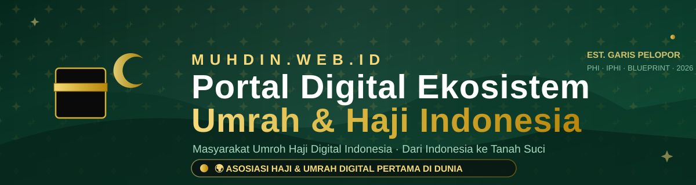

> **بِسْمِ اللَّهِ الرَّحْمَٰنِ الرَّحِيمِ**
> *Dengan nama Allah Yang Maha Pengasih, Maha Penyayang*



# 🕋 MUHDIN.ID — v12.3.0 «AMANAH»

### **MU**asyarakat **U**mroh **H**aji **D**igital **I**ndonesia

*Portal Digital Ekosistem Umrah & Haji Indonesia — Dari Indonesia ke Tanah Suci*
*The Digital Home for Indonesia's Umrah & Hajj Ecosystem — From Indonesia to the Holy Land*
*المنصة الرقمية لمنظومة العمرة والحج الإندونيسية — من إندونيسيا إلى الأرض المقدسة*

[](https://nextjs.org)
[](https://react.dev)
[](https://typescriptlang.org)
[](https://tailwindcss.com)
[](https://prisma.io)
[](#strategi-database)
[](#internasionalisasi)
[](#keamanan-dan-rbac)
[](#tema-gelap-pwa-dan-animasi)
[](#notifikasi-10-kejadian--2-kanal)

> 🕌 **GRATIS SELAMANYA** — pendaftaran & iuran **Rp 0** untuk semua anggota, tanpa pengecualian. Itu keunggulan MUHDIN dibanding asosiasi lain, dan seluruh portal konsisten menyampaikan satu pesan itu.

**v12.3.0 «AMANAH»** dibangun di atas fondasi **v12.0.0 «GABUNG»** — dua garis pengembangan besar portal ini (**garis fitur v6**: Marketplace, Forum, Kartu Jamaah, Pusat Bisnis, Pindai Izin 360°, dll. dan **garis v11.1**: Akademi, KTA Digital, Booking Slot, Benefit, Paspor Haji QR, GPS Tracking, Tur 360°, WA-AI Bot) yang kini **menjadi satu codebase utuh** — ditambah **God-Mode Izin Compliance Checker** (papan kepatuhan izin ber-skor, grade A–E, risiko & tren), **99 Roadmap Upgrade** (peta jalan 99 item granular × 6 pilar hingga v20), dan sprint keamanan **«AMANAH»**: 2FA TOTP per akun admin, kebijakan sandi + lockout brute-force, dan backup terjadwal ber-drill pemulihan. Semua fitur hidup, satu database, satu CMS, tiga bahasa.

---

## 📑 Isi

1. [MUHDIN dalam 30 Detik](#-muhdin-dalam-30-detik)
2. [Peta Fitur Lengkap](#-peta-fitur-lengkap)
3. [Notifikasi: 10 Kejadian × 2 Kanal](#-notifikasi-10-kejadian--2-kanal)
4. [Tema Gelap, PWA dan Animasi](#-tema-gelap-pwa-dan-animasi)
5. [Jalankan Lokal](#-jalankan-lokal)
6. [Akun Demo CMS](#-akun-demo-cms)
7. [Strategi Database](#-strategi-database)
8. [Arsitektur Sistem](#-arsitektur-sistem)
9. [Peta API](#-peta-api)
10. [Internasionalisasi](#-internasionalisasi)
11. [Keamanan dan RBAC](#-keamanan-dan-rbac)
12. [Struktur Proyek](#-struktur-proyek)
13. [Skrip Referensi](#-skrip-referensi)
14. [Deployment](#-deployment)
15. [Garis Waktu Versi](#-garis-waktu-versi)

---

## 🕋 MUHDIN dalam 30 Detik

MUHDIN adalah **asosiasi digital pertama** yang mempertemukan seluruh rantai layanan perjalanan ibadah — PPIU, PIHK, KBIHU, IPHI, travel wisata halal, hingga UMKM — dalam satu ekosistem terpercaya: satu data, satu standar, satu pengalaman.

| Angka | Artinya |
| --- | --- |
| **60 model** Prisma | Skema data terpadu hasil gabungan dua garis + compliance + roadmap |
| **40+ rute halaman** portal publik | Beranda → ekosistem → layanan digital → trust center |
| **36+ modul CMS** | Semua konten & transaksi dikelola tanpa sentuh kode |
| **10 kejadian notifikasi × 2 kanal** | Email sekretariat + WhatsApp admin, otomatis |
| **3 bahasa (ID/EN/AR)** | Arab sungguhan RTL, bukan tempelan |
| **Rp 0** | Pendaftaran & iuran — gratis selamanya |

---

## 🌟 Peta Fitur Lengkap

### 🏛️ Portal & Infrastruktur Kepercayaan
- **13 Ekosistem terintegrasi** + alur perjalanan (journey) + roadmap 2026-2030
- **Trust Center 8 halaman**: Regulasi, Transparansi, Etik Publik, Perlindungan Data Pribadi, Kalkulator DAM, Widget Verifikasi, Kesehatan Jamaah, **Posko Darurat** (nomor resmi Saudi + direktori SOS live: KJRI, KKI, RS — dari database)
- **Direktori Anggota** terverifikasi + halaman detail per anggota + **Widget & QR verifikasi** publik
- **Statistik Nasional** transparansi + **Global Search ⌘K** (Ctrl/⌘+K, satu kotak cari semua entitas)
- **Berita, Tutorial bertingkat (Pemula/Menhir/Mahir), Agenda, Galeri, Unduhan, Pengaduan, Lacak Tiket** — semua ber-CMS

### 🛒 Garis v6 — Ekosistem Hulu-Hilir
- **Marketplace Paket** (`#/paket`) — katalog paket umrah/haji anggota + halaman detail + pipeline **booking paket** dengan verifikasi
- **Forum Jamaah** (`#/forum`) — diskusi per topik + balasan + **moderasi CMS**
- **Kartu Jamaah Digital QR** (`#/kartu`) — kartu identitas jamaah per rombongan, pemindaian verifikasi (`#/pindai` juga memindai izin)
- **Pusat Bisnis B2B** (`#/bisnis`) — **bursa kursi** (seat exchange antar penyelenggara), **direktori vendor**, **registry muthowif**, **kepatuhan & compliance docs**, **jamaah docs**
- **Brankas Jamaah** (`#/vault`) + **Trip Composer** — susun itinerary per segmen
- **Pindai Izin 360°** (`#/pindai`) — ⭐ *god mode*: masukkan **NIB/nomor izin** → mesin `license-engine` membuka dossier kelengkapan **BPW/PPIU/PIHK/IATA/akreditasi** + checklist prioritas **a–l**, tertaut mitra sertifikasi
- **Ulasan (reviews)** jamaah per penyelenggara

### 🎓 Garis v11 — Keanggotaan Power Pack
- **KTA Digital** (`#/kartu-anggota`) — kartu anggota otomatis untuk semua anggota terverifikasi, **poin & PointLedger**, **kode referal** (approve pendaftaran = poin ke perujuk), verifikasi publik `#/verifikasi-kta/KTA-…`
- **Manasik Academy** (`#/academy`) — kursus trilingual berjenjang + **quiz** + **sertifikat digital ber-QR** (`#/verifikasi-sertifikat/SERT-…`)
- **Booking Slot Layanan** (`#/booking`) — kelas manasik, konsultasi syariah, klinik vaksin — kapasitas & jadwal terkelola
- **Benefit & Poin** (`#/benefit`) — katalog benefit mitra + penebusan poin KTA (BNF)
- **Paspor Haji Digital** (`#/paspor`) — identitas jamaah ber-QR + verifikasi lapangan `#/verifikasi-paspor/PH-…`
- **GPS Tracking Rombongan** (`#/tracking`) — peta **Leaflet** real-time + riwayat **GpsPing** per device
- **Tur Virtual 360°** (`#/tur-virtual`) — Photo Sphere Viewer panorama situs suci, multi-scene (**TourScene**)
- **WhatsApp AI Bot** (`#/whatsapp-ai`) — otak bot + **webhook `/api/whatsapp/webhook`** ber-`X-Webhook-Token`, balasan otomatis bisa dimatikan dari CMS (`botEnabled`)

### 🛡️ v12.1 — God-Mode Izin Compliance Checker
- **Compliance Center** (`#/compliance`) — ⭐ *god mode tier max*: papan kepatuhan **seluruh perusahaan registri** dihitung live oleh engine Pindai Izin 360° — **skor 0–100**, **grade A–E**, **level risiko** (RENDAH→KRITIS), **tren antar-audit**, dan **dossier drill-down** per perusahaan (checklist a–l berwarna status + rekomendasi berprioritas + tren skor) — publik & transparan
- **Audit god-mode dari CMS** (modul *Compliance Checker*) — satu klik menilai registri penuh, menyimpan snapshot **ComplianceScore** (riwayat tren) + **temuan berprioritas** (`ComplianceFinding`, tier 0 darurat … 4 nilai tambah) + agregat **ComplianceAudit**, lalu meneruskan ringkasan ke sekretariat via **Email & WhatsApp** (saklar `notifyCompliance`)
- **Deep-link** `#/compliance?q=<companyId>` membuka dossier langsung · menu **PERIZINAN → Compliance Center** · i18n 3 bahasa penuh

### 🔐 v12.3 «AMANAH» — Sprint Keamanan (P0 Roadmap)
- **2FA TOTP per akun admin** (`R-074`) — implementasi RFC 6238 mandiri (`node:crypto`, tanpa dependensi baru): setup **QR authenticator** + kode manual di CMS (*Keamanan Akun*), kode 6 digit/30 detik, **tantangan saat login** (tanpa sesi dibuat sebelum kode benar), verifikasi timing-safe ±1 langkah, audit `2FA_ENABLE/DISABLE`
- **Kebijakan sandi + lockout brute-force** (`R-075`) — sandi wajib huruf+angka (dari daftar sandi umum ditolak) di semua titik set-password; **5× gagal/15 menit per email → kunci 15 menit** (kode 2FA salah ikut terhitung), rate-limit login **10×/menit per IP**, peristiwa penguncian masuk jejak audit
- **Backup terjadwal + drill pemulihan** (`R-063`) — `bun run backup`: snapshot SQLite → **integrity_check + hitung baris tabel kunci** (pemulihan terbukti) → retensi 14 snapshot terakhir; contoh crontab produksi terdokumentasi
- **Loop roadmap pertama tercatat**: 3 item P0 naik status → **27 selesai / 99 (27%)** di peta jalan portal

### 🗺️ v12.2 — 99 Roadmap Upgrade
- **99 item granular, 6 pilar** — *Pengalaman Jamaah (18) · Akademi & KTA (16) · Marketplace & Bisnis (17) · Platform & Teknologi (18) · Keamanan & Kepatuhan (15) · Ekosistem & Pertumbuhan (15)* — di bawah 4 fase makro 2026-2030
- **Status jujur per v12.1**: 24 *Sudah hidup* · 16 *Dikerjakan* · 59 *Direncanakan* — dengan **prioritas P0–P3**, **upaya S/M/L/XL**, dan **target versi v12.2→v20** per item
- **Seksi portal interaktif** (`#/tentang`) — 4 kartu statistik, **bar progres 24/99**, filter pilar & status, grid kartu ber-animasi Reveal, CTA *usulkan upgrade ke-100* via WA resmi
- **Modul CMS** (*Roadmap 99 Upgrade*) — CRUD penuh via CrudManager: kode unik `R-001…R-099`, pilar, prioritas, status, target, urutan
- Model **RoadmapItem** + API publik `GET /api/roadmap/items` + CRUD admin · i18n 3 bahasa penuh

### 🤖 Kecerdasan Buatan
- **Sahabat MUHDIN** — AI concierge mengapung di semua halaman publik (trilingual, tahu batas: menyarankan WA resmi & halaman verifikasi, tidak mengarang regulasi)
- **AI Content Studio** di CMS — redaksi artikel berbantuan AI (topik → draf 350-500 kata)
- **Penerjemah Cerdas** — sinergi translate-engine untuk konten DB ×3 bahasa

### 💬 Notifikasi: 10 Kejadian × 2 Kanal

| Kejadian | Email | WhatsApp |
| --- | --- | --- |
| Pesan kontak | ✅ | ✅ |
| Pendaftaran anggota (+nomor urut live) | ✅ | ✅ |
| Pengaduan jamaah | ✅ | ✅ |
| Langganan newsletter | ✅ | ✅ |
| Testimoni baru | ✅ | ✅ |
| **Enroll Akademi** (v11) | ✅ | ✅ |
| **Lulus quiz / sertifikat** (v11) | ✅ | ✅ |
| **Booking slot layanan** (v11) | ✅ | ✅ |
| **Tebus benefit** (v11) | ✅ | ✅ |
| **Audit kepatuhan izin** (v12.1) | ✅ | ✅ |

Provider email SMTP (App Password Gmail) + provider WA **FONNTE / WABLAS / CALLMEBOT (gratis) / CUSTOM** — semua disaklarkan per-kejadian dari CMS (Notifikasi & WhatsApp), lengkap dengan **NotificationLog** audit + tombol uji kirim.

---

## 🎨 Tema Gelap, PWA dan Animasi

Identitas visual **forest-gold**: hijau hutan pekat + aksen emas, pola islamic-pattern, watermark raksasa.

- **Gold divider beranimasi** di puncak footer + glow ambient + reveal-on-scroll (IntersectionObserver) di semua section
- **FAB WhatsApp** mengapung dengan denyut "online" emas — satu nomor resmi **+62 812-2234-5856** di seluruh portal (FAB, footer, kontak, dashboard, detail, AI prompts, CMS)
- **Slot counter live** — penghitung pendaftar gratis real-time (`/api/promo/counter`)
- **Dark mode** kelas `dark` + switcher tema bertahan via localStorage; **RTL penuh** saat bahasa Arab (`dir="rtl"` + `icon-flip` otomatis)
- **PWA installable** — service worker scope `/`, manifest + ikon apple, shell tetap tampil saat offline
- Skeleton loading, toast, dialog & sheet — semuanya komponen shadcn/ui yang konsisten

---

## 🚀 Jalankan Lokal

Prasyarat: [Bun](https://bun.sh) ≥ 1.1 (atau Node ≥ 20 + npm/pnpm).

```bash
# 1. Dependensi (postinstall otomatis generate Prisma Client)
bun install

# 2. Basis data — salin contoh env
cp .env.example .env         # SQLite dev: DATABASE_URL=file:./db/custom.db
bunx prisma db push          # buat 56 tabel

# 3. Data demo (idempoten — urutan bebas)
bun prisma/seed.ts                   # inti: user CMS, anggota, ekosistem, artikel…
bun prisma/seed-nusuk.ts             # hub Nusuk
bun prisma/seed-fitur-v5.ts          # marketplace + forum + kartu jamaah
bun prisma/seed-fitur-v6.ts          # pusat bisnis, brankas, SOS, vendor…
bun prisma/seed-fitur-v7.ts          # pindai izin 360°
bun scripts/seed-membership.ts       # KTA + poin + akademi + slot + benefit
bun scripts/seed-compliance.ts       # riwayat audit & tren kepatuhan izin (v12.1)
bun scripts/seed-roadmap99.ts        # 99 item roadmap upgrade 6 pilar (v12.2)
bun scripts/seed-kontak-resmi.ts     # WA resmi + kantor Jakarta/Tasikmalaya
bun scripts/seed-resource-lengkap.mjs

# 4. Jalan
bun run dev                  # → http://localhost:3000
```

Skrip produksi: `bun run build` (generate + next build + post-build) · `bun run start` · `bun run lint`.

---

## 🔑 Akun Demo CMS

| Peran | Email | Catatan |
| --- | --- | --- |
| Super Admin | `admin@muhdin.web.id` | Akses penuh 36+ modul + Kelola Admin |

> ⚠️ Sandi demo ada di `prisma/seed.ts` (untuk sandbox/demo lokal). **Ganti segera** bila portal dipasang di server publik: CMS → Kelola Admin → Ubah sandi. Login: `#/admin`.

---

## 🗄️ Strategi Database

Satu skema **60 model** (union dua garis + compliance checker + roadmap item), dua mode jalankan:

| Mode | Provider | Cara |
| --- | --- | --- |
| **Dev/sandbox** (default) | SQLite | `DATABASE_URL=file:./db/custom.db` → `bunx prisma db push` |
| **Produksi** (siap pakai) | PostgreSQL | Ganti provider di `prisma/schema.prisma` → `postgresql`, isi `DATABASE_URL=postgres://…`, `bunx prisma generate && bunx prisma db push`. Referensi migrasi data: `scripts/migrate-sqlite-to-postgres.mjs` + `scripts/verify-v111.mjs` (arsip contoh: `db/arsip-v11-sqlite.db`), konfigurasi CLI modern via `prisma.config.ts`, driver adapter `@prisma/adapter-pg` sudah tersedia di dependensi |

File live (`db/`) **tidak pernah** di-commit — berisi data runtime.

Kelompok model: **Auth & RBAC** (User, Role…) · **Keanggotaan** (Member, MembershipApplication + referralCode, MemberCard, PointLedger) · **Perjalanan ibadah** (TourPackage, PackageBooking, PilgrimCard, HajjPassport, GpsPing, TrackingDevice) · **Komunitas** (ForumThread, ForumReply, Testimoni…) · **Akademi** (AcademyCourse, AcademyEnrollment, Certificate) · **Layanan** (ServiceSlot, SlotBooking, Benefit, BenefitRedemption) · **B2B hulu-hilir** (SeatListing, Vendor, Muthowif, RegistryCompany/Doc, ComplianceDoc, JamaahDoc) · **Nusuk** (NusukConnection, NusukPermit, NusukSyncLog) · **Konten & kepercayaan** (Article, Tutorial, FAQ, Agenda, Gallery, Resource, RegionalBranch, SosPoint…) · **Notifikasi** (EmailSetting, WhatsAppSetting, NotificationLog, AiChatLog).

---

## 🧱 Arsitektur Sistem

```
┌──────────────────────────────────────────────────────────────────┐
│  BROWSER — SPA hash-router (#/…) · PWA · dark/light · ID/EN/AR   │
│  Global Search ⌘K · AI Concierge · WA FAB · slot counter live    │
└──────────────────────────────┬───────────────────────────────────┘
                               │ /api/* (Next.js Route Handlers)
┌──────────────────────────────▼───────────────────────────────────┐
│  NEXT.JS 16 — src/app/api · guardRole RBAC · rateLimit · logAudit│
│  ┌────────────┬─────────────┬──────────────┬─────────────────┐   │
│  │ Publik     │ Transaksi   │ Layanan      │ Trust & B2B     │   │
│  │ settings   │ packages    │ academy      │ license-engine  │   │
│  │ members    │ forum       │ slots        │ sos-points      │   │
│  │ track      │ pilgrim-    │ bookings     │ vendors/seat    │   │
│  │ verify     │  cards      │ benefits     │ compliance docs │   │
│  └────────────┴─────────────┴──────────────┴─────────────────┘   │
│  Notifier gagal-aman: email.ts + whatsapp.ts (10×2 kanal)         │
└──────┬───────────────────────┬─────────────────────┬─────────────┘
       │                       │                     │
┌──────▼──────┐        ┌───────▼───────┐     ┌───────▼────────┐
│ Prisma 6    │        │ SMTP / WA     │     │ z-ai-web-dev-  │
│ SQLite ↔ PG │        │ 4 provider    │     │ sdk (AI)       │
│ 60 model    │        │ + webhook bot │     │ concierge/bot  │
└─────────────┘        └───────────────┘     └────────────────┘
```

---

## 🔌 Peta API

Semua respons konsisten `ok()` / `fail()`, audit via `logAudit`, dilindungi `guardRole` + `rateLimit`.

| Grup | Endpoint |
| --- | --- |
| Publik | `/api/settings` · `/api/members` (+verify) · `/api/track` · `/api/stats` (+public/insights) · `/api/rss` · `/api/search` · `/api/health` · `/api/promo/counter` · `/api/applications` (+live/track) |
| Transaksi v6 | `/api/packages` · `/api/package-bookings` · `/api/forum` (+replies/moderation) · `/api/pilgrim-cards` (+verify) · `/api/reviews` |
| B2B v6 | `/api/vendors` · `/api/seat-exchange` · `/api/muthowif` · `/api/license-registry` · `/api/license-scan` · `/api/compliance-docs` · `/api/jamaah-docs` · `/api/trip-composer` · `/api/sos-points` |
| Compliance v12.1 | `/api/compliance/scoreboard` (publik) · `/api/compliance/report?id=` (publik) · `/api/compliance/audit` (POST jalankan · GET riwayat — admin) |
| Layanan v11 | `/api/academy` (courses/enroll/quiz) · `/api/slots` (+book) · `/api/bookings` · `/api/benefits` (+redeem) · `/api/certificates/verify` · `/api/passport` (+verify/qr/public) · `/api/cards` (+verify) · `/api/tracking` (+history) · `/api/tour` (+view) |
| Nusuk | `/api/nusuk` (connection/permits/sync/rotate/logs/verify/webhook/public) · `/api/ppiu-pihk` (+sync) |
| Notifikasi | `/api/email-settings` · `/api/whatsapp` (+bot/webhook) · `/api/notifications` |
| CMS | `/api/articles` · `/api/tutorials` (+slug) · `/api/faqs` · `/api/testimonials` · `/api/messages` · `/api/complaints` · `/api/branches` · `/api/management` · `/api/ecosystems` · `/api/journey` · `/api/roadmap` · `/api/gallery` · `/api/agenda` · `/api/resources` · `/api/subscribers` · `/api/users` · `/api/audit` · `/api/backup` · `/api/export` · `/api/translations` · `/api/widget/verify` · `/api/ai/chat` · `/api/ai/ghostwrite` |

---

## 🌍 Internasionalisasi

- Tiga locale penuh: **Indonesia, English, العربية** — setiap namespace satu file di `src/lib/i18n/locales/*.ts` (36+ modul, hasil union dua garis)
- Bahasa Arab = **RTL sungguhan**: `dir="rtl"` pada `<html>`, ikon membalik via `.icon-flip`, angka & telepon tetap `dir="ltr"`
- Locale bertahan lewat cookie `muhdin-locale` (1 tahun) — switcher di navbar + menu mobile
- Konten dari database (anggota, artikel, layanan) disimpan trilingual `{ id, en, ar }` + **Penerjemah Cerdas** di CMS untuk menerjemahkan sekali klik

---

## 🔐 Keamanan dan RBAC

- **4 peran** — SUPER_ADMIN · ADMIN · EDITOR · VERIFIKATOR — matriks `src/lib/roles.ts` mengatur 36+ seksi CMS
- Setiap API: `guardRole()` → 401/403 konsisten; **rate limit** per-IP untuk formulir publik; **logAudit** untuk semua aksi tulis CMS
- Sandi hash (bcryptjs), sesi cookie httpOnly, manajemen admin (aktif/nonaktif, reset sandi) dari CMS
- Webhook WA-AI diverifikasi header `X-Webhook-Token` (`botWebhookSecret`)
- Nomor darurat & data PIC pihak ketiga dipisah dari kanal resmi (satu nomor WA resmi: **0812 2234 5856**)

---

## 📁 Struktur Proyek

```
src/
├── app/
│   ├── api/                # 60+ route handler (lihat Peta API)
│   └── page.tsx            # shell SPA
├── components/
│   ├── site/               # navbar, footer, FAB, global-search, tour-360, tracking-map…
│   ├── views/              # 45+ halaman portal (hash-router)
│   └── admin/              # 36+ modul CMS
├── lib/
│   ├── i18n/               # index + dictionaries + locales/ (3 bahasa)
│   ├── license-engine.ts   # ⭐ mesin dossier izin (BPW/PPIU/PIHK, checklist a–l)
│   ├── nusuk-engine.ts     # sinkronisasi & verifikasi Nusuk
│   ├── membership.ts       # KTA, poin, referal
│   ├── email.ts whatsapp.ts# notifier 10×2 kanal
│   └── api-helpers.ts audit.ts auth.ts ratelimit.ts roles.ts…
└── generated/prisma/       # (opsional) client hasil generate
prisma/
├── schema.prisma           # 60 model — union dua garis + compliance checker + roadmap item
└── seed*.ts                # seed idempoten per fitur
scripts/                    # seed-membership, seed-compliance, seed-roadmap99, kontak-resmi, migrate-sqlite-to-postgres, verify, dev-keep…
shared-hosting/             # varian PHP murni (API tanpa Node) — lihat PANDUAN-SHARED-HOSTING.md
docs/                       # aset & tangkapan layar
```

---

## 🧰 Skrip Referensi

| Skrip | Fungsi |
| --- | --- |
| `scripts/dev-keep.sh` | Nyalakan/jaga dev server :3000 |
| `prisma/seed.ts` | Seed inti (idempoten, hapus-isi-ulang) |
| `prisma/seed-fitur-v5/v6/v7.ts` | Seed marketplace/forum/kartu, bisnis/SOS, pindai izin |
| `scripts/seed-membership.ts` | KTA + poin + akademi + slot + benefit |
| `scripts/seed-compliance.ts` | Riwayat audit + tren kepatuhan izin (ComplianceAudit/Score/Finding) |
| `scripts/seed-roadmap99.ts` | 99 item upgrade 6 pilar (RoadmapItem — status jujur per v12.3) |
| `scripts/backup-db.ts` | Snapshot + drill pemulihan + retensi 14 terakhir (`bun run backup`) |
| `scripts/seed-kontak-resmi.ts` | WA resmi 0812 2234 5856 + kantor resmi |
| `scripts/migrate-sqlite-to-postgres.mjs` | Migrasi 42+ tabel → Postgres (topologis, batch) |
| `scripts/verify-v111.mjs` | Verifikasi pasca-migrasi |
| `scripts/cleanup-e2e.ts` `test-license-engine.ts` | Utilitas QA |

---

## 📦 Deployment

### Opsi 1 — Vercel (+ PostgreSQL)
1. Push repo → [vercel.com/new](https://vercel.com/new) → Import.
2. Siapkan Postgres (Neon/Supabase/Prisma Postgres) → flip provider di `prisma/schema.prisma` → `postgresql`, set `DATABASE_URL` di Environment Variables.
3. `bunx prisma db push` dari lokal (atau job build) → Deploy. Isi kredensial SMTP/WA dari CMS.

### Opsi 2 — VPS / Node self-host
`bun run build && bun run start` di belakang Nginx/Caddy (contoh `Caddyfile` tersedia) + SQLite atau Postgres sesuai pilihan.

### Opsi 3 — Shared hosting PHP
Varian API PHP murni tanpa Node (`shared-hosting/`, `PANDUAN-SHARED-HOSTING.md`, `INSTALL.txt`) untuk frontend statis + form gateway.

---

## 🧭 Garis Waktu Versi

| Versi | Sorotan |
| --- | --- |
| v3.1 | Portal + trust center + shared hosting PHP |
| v4.x | AI concierge, halaman detail, PWA, papan slot live |
| **v5.0** | **Marketplace Paket · Forum Jamaah · Kartu Jamaah QR** |
| **v6.0** | **Pusat Bisnis B2B · Brankas · Trip Composer · SOS · Vendor · Muthowif · Ulasan** |
| **v7.0** | **Pindai Izin 360° — mesin dossier NIB → checklist a–l** |
| v10 | Statistik nasional · global search ⌘K · tur 360° · tracking GPS |
| **v11.1** | **KTA + poin + referal · Akademi + sertifikat · Booking slot · Benefit · Paspor QR · WA-AI bot · notifikasi 9×2** |
| **v12.0 «GABUNG»** | **Union dua garis: 56 model, semua fitur hidup, satu CMS, tiga bahasa** |
| **v12.1 «GOD MODE»** | **God-Mode Izin Compliance Checker: scoreboard publik, grade A–E, risiko, tren antar-audit, audit CMS 1-klik, notifikasi 10×2** |
| **v12.2 «99 ROADMAP»** | **Peta jalan 99 upgrade granular × 6 pilar: portal interaktif + filter + progres, modul CMS CRUD, API publik, seed 99 item** |
| **v12.3 «AMANAH»** | **Sprint keamanan P0: 2FA TOTP admin, kebijakan sandi + lockout brute-force, backup terjadwal ber-drill — 27/99 roadmap selesai** |

---

> 🤲 *Dibangun dengan amanah untuk tamu Allah — Bersama Melayani Tamu Allah.*
> MUHDIN INDONESIA · muhdin.id · WA resmi +62 812-2234-5856 · **GRATIS SELAMANYA**
